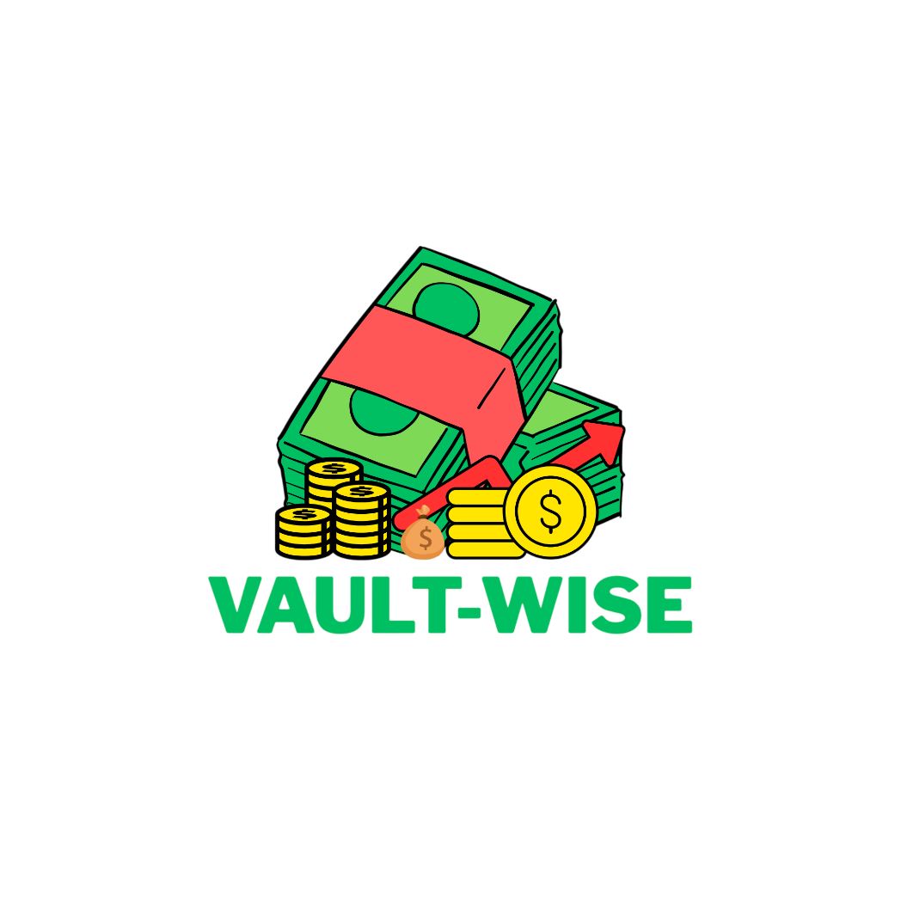

<div align="center">



# 💎 Vaultwise
### *Your Money. Your Rules.*

[](https://git.io/typing-svg)

<br/>


&nbsp;&nbsp;&nbsp;&nbsp;

&nbsp;&nbsp;&nbsp;&nbsp;

&nbsp;&nbsp;&nbsp;&nbsp;

&nbsp;&nbsp;&nbsp;&nbsp;

&nbsp;&nbsp;&nbsp;&nbsp;

&nbsp;&nbsp;&nbsp;&nbsp;


<br/><br/>

[](https://fastapi.tiangolo.com)
[](https://react.dev)
[](https://www.typescriptlang.org)
[](https://vitejs.dev)
[](https://tailwindcss.com)
[](https://sqlite.org)

<p align="center">
  <strong>A secure, private, and mathematically precise personal wealth & financial statement generation suite.</strong>
</p>


</div>

---

Vaultwise helps individuals understand, organize, and analyze personal finances without relying on third-party aggregators or cloud surveillance. Record income and expenses, establish budgets, inspect spending history, import bank statements, and discover actionable spending patterns.

---

## 📌 Dedicated Guides & Documentation

- 🚀 **[how to run.md](file:///d:/projects%20and%20certificates/projects/uilities%20and%20others/Vault%20wise/how%20to%20run.md)** — Complete step-by-step run instructions for Backend (FastAPI) and Web (React 19) with troubleshooting and demo credentials.
- 📦 **[packages and extensions needed.md](file:///d:/projects%20and%20certificates/projects/uilities%20and%20others/Vault%20wise/packages%20and%20extensions%20needed.md)** — Exhaustive inventory of VS Code extensions, system runtimes, Python packages, and npm dependencies.

---

## 💎 Design System & Visual Philosophy

Vaultwise implements a distinctive, high-impact aesthetic blending **Neumorphism + Flat Design + Neo-Brutalism**:

1. **Neo-Brutalism (Bold & Tactile Outer Frame)**:
   - **Thick 2px Solid Outlines**: Crisp `border-2 border-slate-900` on cards, inputs, tables, and buttons.
   - **Hard Offset Shadows**: Unblurred tactile shadows (`shadow-[4px_4px_0px_#0f172a]`).
   - **Physical Press Feedback**: Elements lift on hover (`-translate-x-0.5 -translate-y-0.5`) and physically depress on click (`active:translate-x-1 active:shadow-none`).
   - **High-Contrast Badges**: Uppercase bold badge chips with solid borders.

2. **Neumorphism (Tactile Inset Wells)**:
   - **Debossed Inputs (`.neu-input`)**: Inward shadow wells for search boxes, form fields, and dropdowns (`shadow-[inset_2px_2px_4px_rgba(0,0,0,0.1),inset_-2px_-2px_4px_rgba(255,255,255,0.7)]`).
   - **Tactile Progress Tracks**: Inset groove tracks with solid progress fills for monthly budget limits.

3. **Flat Design Cleanliness**:
   - **Zero Gradients Rule**: Absolutely no linear, radial, or mesh gradients (`background-image: none !important`).
   - **Solid Palette**: Slate-900 `#0f172a`, Royal Blue `#2563eb`, Emerald `#10b981`, Danger Red `#ef4444`, and Amber `#f59e0b`.

4. **Permanent Clean Light Mode**:
   - High-contrast, distraction-free daylight fintech aesthetic with pure white and slate surfaces for maximum legibility.

---

## 📊 Interactive Data Visualizations & Reports

### 1. Interactive Pie Chart with Pop-Out Segments

- **Radial Pop-Out (`activeShape`)**: Hovering over any slice causes it to expand **+10px outward** with a bold solid border (`stroke="#0f172a"`, `strokeWidth: 2.5px`) and an outer accent halo ring.
- **Background Dimming (`inactiveShape`)**: Remaining unselected slices gracefully dim to **40% opacity** to focus attention on the active category.
- **Center Donut Stat Card**: Donut center dynamically updates on hover with the category name, formatted monetary value, and percentage share badge.
- **Bidirectional Legend Sync**: Hovering the pie highlights the corresponding row in the side table, and hovering any legend row automatically triggers the slice pop-out in the chart.

### 2. Parameter-Filtered PDF Statements with Watermark

- **Parameter-Filtered Category Pie Chart**: Statement automatically generates a vector pie chart matching selected filters (`start_date`, `end_date`, `category_id`, `type`).
- **Brand Logo Watermark**: The official Vaultwise logo is embedded at **0.07 opacity** across all statement pages using a custom `WatermarkCanvas`, providing security document authenticity while ensuring ledger numbers remain 100% legible.
- **Structured Ledgers & Page Footers**: Includes KPI summary cards (Income, Spending, Savings, Count), high-contrast table styling, and dynamic running page footers (`Page X`).

---

## 🌍 Global Multi-Currency Support

Vaultwise features a **Global Currency Switcher** in the top navigation header:

- **Instant Recalculation**: Switching currency updates display symbols across all 6 KPI cards, budget limits, transaction registers, and historical comparisons.
- **18 Supported Currencies**:
  - **INR** (`₹`) — Indian Rupee
  - **USD** (`$`) — US Dollar
  - **EUR** (`€`) — Euro
  - **GBP** (`£`) — British Pound
  - **JPY** (`¥`) — Japanese Yen
  - **CAD** (`CA$`) — Canadian Dollar
  - **AUD** (`AU$`) — Australian Dollar
  - **AED** (`AED`) — UAE Dirham
  - **SAR** (`SAR`) — Saudi Riyal
  - **SGD** (`S$`) — Singapore Dollar
  - **CHF** (`Fr`) — Swiss Franc
  - **CNY** (`¥`) — Chinese Yuan
  - **BRL** (`R$`) — Brazilian Real
  - **ZAR** (`R`) — South African Rand
  - **KRW** (`₩`) — South Korean Won
  - **RUB** (`₽`) — Russian Ruble
  - **MXN** (`$`) — Mexican Peso
  - **NZD** (`$`) — New Zealand Dollar
- **Searchable Dropdown**: Real-time filter by currency code, country name, or symbol.

---

## 🛡️ Core Architectural Principles

- **Accuracy Before Decoration**: All monetary operations use precision-safe integer minor units (cents) or fixed-point decimals. Zero binary floating-point rounding errors.
- **Strict Data Isolation**: The **Web Application** and **Windows Desktop Application** maintain completely separate datasets. There is **no automatic synchronization** and **no silent cloud uploads**.
- **Defensive File Handling**: CSV and Excel statement imports are sanitized; spreadsheet formulas and macros are disabled to prevent formula injection.
- **Verified Local Encryption**: Desktop records are stored in an encrypted SQLite database protected by SQLCipher AES-256 and Windows Data Protection (DPAPI).
- **Brand Identity**: Transparent background high-resolution logo (`logo.png`, `favicon.png`) with clean contours and no white background bounding boxes.

---

## 📱 Applications & Tech Stack

| Technology       |                                                                 Real-Life Logo                                                                  |    Version     | Role in Vaultwise                              |
| :--------------- | :---------------------------------------------------------------------------------------------------------------------------------------------: | :------------: | :--------------------------------------------- |
| **Python**       |                  | `3.12+ / 3.14` | Backend programming runtime                    |
| **FastAPI**      |               |   `^0.115.0`   | Asynchronous high-performance REST API         |
| **React**        |                     |    `19.3.1`    | Component-based UI frontend                    |
| **TypeScript**   |      |    `~7.0.2`    | Static type safety and developer productivity  |
| **Vite**         |                    |    `^8.3.4`    | Frontend bundler & dev server                  |
| **Tailwind CSS** |  |   `^3.4.19`    | Neumorphic + Neo-Brutalist utility system      |
| **SQLite**       |                  |  `3.x / FFI`   | Local development database storage             |
| **PostgreSQL**   |      |     `16+`      | Production relational database                 |
| **SQLAlchemy**   |      |   `^2.0.38`    | Modern async Python ORM                        |

---

## 📂 Repository Structure

```
vaultwise/
├── how to run.md                    # Detailed run instructions & demo accounts
├── packages and extensions needed.md # Complete inventory of packages & extensions
├── apps/
│   └── web/                         # React 19 + Vite web application
│       ├── dist/                    # Compiled production build artifacts
│       ├── src/
│       │   ├── components/          # Card, Modal, Badge, Header, Sidebar, CurrencySwitcher
│       │   ├── constants/           # Currency definitions & formats
│       │   ├── features/            # Auth, Dashboard, Transactions, Budgets, History, Reports, Settings
│       │   ├── services/            # REST API client & file downloaders
│       │   └── test/                # Vitest unit & component test suites
├── services/
│   └── api/                         # FastAPI backend (PostgreSQL/SQLite, Alembic, Auth)
│       ├── app/                     # Routers, schemas, business logic, analytics engine
│       │   ├── assets/              # Brand logo & static report assets
│       │   ├── services/            # Export engine (PDF pie charts & watermark canvas)
│       │   └── tests/               # Pytest integration & security test suites
│       └── vaultwise_dev.db         # Active development database
├── packages/
│   └── shared-specs/                # Calculation rules and shared data schemas
├── docs/                            # Complete technical documentation
│   ├── FEATURES.md                  # 14-point audit of all implemented features
│   ├── ARCHITECTURE.md              # System design & Web data architecture
│   ├── DATABASE.md                  # Schemas, precision rules & migrations
│   ├── API.md                       # OpenAPI REST endpoint specifications
│   ├── SECURITY.md                  # Threat model & encryption architecture
│   ├── UI_UX.md                     # Design system tokens (Solid colors only)
│   ├── TESTING.md                   # Test matrix & edge cases
│   ├── IMPORT_EXPORT.md             # CSV/Excel parsing and report specifications
│   ├── WEB_DEPLOYMENT.md            # Production web deployment and reverse proxy
│   └── DEVELOPMENT_LOG.md           # Timestamped engineering progress log
├── .env.example                     # Environment variable template
├── .gitignore                       # Version control exclusion rules
└── README.md
```

---

## 🚀 Quick Start & Development Setup

For comprehensive instructions, see **[how to run.md](file:///d:/projects%20and%20certificates/projects/uilities%20and%20others/Vault%20wise/how%20to%20run.md)**.

### 1. Backend Setup (`services/api`)

```powershell
cd services/api
python -m venv .venv
.\.venv\Scripts\Activate.ps1
pip install -r requirements.txt
cp ../../.env.example .env
alembic upgrade head
uvicorn app.main:app --reload --port 8000
```

- **Backend API**: `http://127.0.0.1:8000`
- **Interactive Swagger Docs**: `http://127.0.0.1:8000/docs`

### 2. Web Frontend Setup (`apps/web`)

```powershell
cd apps/web
npm install
npm run dev
```

- **Active Dev Server**: `http://localhost:5173/`

---

## 📦 Build Artifacts & Output Locations

### Web Application Production Build

- **Build Output Directory**: [`apps/web/dist/`](file:///d:/projects%20and%20certificates/projects/uilities%20and%20others/Vault%20wise/apps/web/dist/)
- **Build Command**:
  ```powershell
  cd apps/web
  npm run build
  ```
- **Production Preview Server**:
  ```powershell
  cd apps/web
  npm run preview
  ```
  _Active preview URL:_ `http://localhost:4173/`
- **Output Artifacts**:
  - `index.html`: Optimized Single Page Application shell.
  - `assets/`: Minified JavaScript chunks (`index-*.js`) and CSS bundles (`index-*.css`).
  - `logo.png` & `favicon.png`: High-resolution transparent brand icons.
  - `manifest.json` & `icons/`: PWA offline manifest and icons.

---

## 🔑 Pre-configured Demo Account

For instant evaluation of the Web Application:

- **Web App URL**: `http://localhost:4173/` (or `http://localhost:5173/` in dev mode)
- **Email**: `demo@vaultwise.com`
- **Password**: `Password123!`
- _Tip: Click the **"Fill Demo Account"** button on the Login page for one-click autofill._

---

## 🧪 Running Automated Tests

<details open>
<summary><b>▶ Click to expand / collapse Test Suites</b></summary>
<br/>

- **Backend Test Suite (Pytest)**:
  ```powershell
  cd services/api
  pytest -v
  ```
  _6/6 test suites passed (auth, transactions, analytics, budgets, CSV/Excel/PDF exports)._
- **Web Frontend Test Suite (Vitest)**:
  ```powershell
  cd apps/web
  npm test -- --run
  ```
  _4/4 test files, 8/8 tests passed (currency switching, summary cards, pie chart hover pop-out, authentication flows)._

</details>

---

## 📚 Technical Documentation Links

<details>
<summary><b>📖 Explore Deep Architecture & Specifications (Click to expand)</b></summary>
<br/>

- [docs/FEATURES.md](file:///d:/projects%20and%20certificates/projects/uilities%20and%20others/Vault%20wise/docs/FEATURES.md) — 14-point audit of all implemented features
- [docs/ARCHITECTURE.md](file:///d:/projects%20and%20certificates/projects/uilities%20and%20others/Vault%20wise/docs/ARCHITECTURE.md) — System architecture & data structure
- [docs/DATABASE.md](file:///d:/projects%20and%20certificates/projects/uilities%20and%20others/Vault%20wise/docs/DATABASE.md) — Database schemas & integer precision rules
- [docs/API.md](file:///d:/projects%20and%20certificates/projects/uilities%20and%20others/Vault%20wise/docs/API.md) — REST API endpoint documentation
- [docs/SECURITY.md](file:///d:/projects%20and%20certificates/projects/uilities%20and%20others/Vault%20wise/docs/SECURITY.md) — Threat model & encryption architecture
- [docs/UI_UX.md](file:///d:/projects%20and%20certificates/projects/uilities%20and%20others/Vault%20wise/docs/UI_UX.md) — Design system tokens & Neumorphism + Neo-Brutalism combo
- [docs/TESTING.md](file:///d:/projects%20and%20certificates/projects/uilities%20and%20others/Vault%20wise/docs/TESTING.md) — Test matrix & edge case verification
- [docs/IMPORT_EXPORT.md](file:///d:/projects%20and%20certificates/projects/uilities%20and%20others/Vault%20wise/docs/IMPORT_EXPORT.md) — Statement import/export engine
- [docs/WEB_DEPLOYMENT.md](file:///d:/projects%20and%20certificates/projects/uilities%20and%20others/Vault%20wise/docs/WEB_DEPLOYMENT.md) — Production web deployment and reverse proxy
- [docs/DEVELOPMENT_LOG.md](file:///d:/projects%20and%20certificates/projects/uilities%20and%20others/Vault%20wise/docs/DEVELOPMENT_LOG.md) — Engineering progress log

</details>

---

<div align="center">


<sub>Vaultwise — Financial Statement & Personal Wealth Management (Your Money. Your Rules.)</sub>

<br/>

[](file:///d:/projects%20and%20certificates/projects/uilities%20and%20others/Vault%20wise/LICENSE)

</div>
